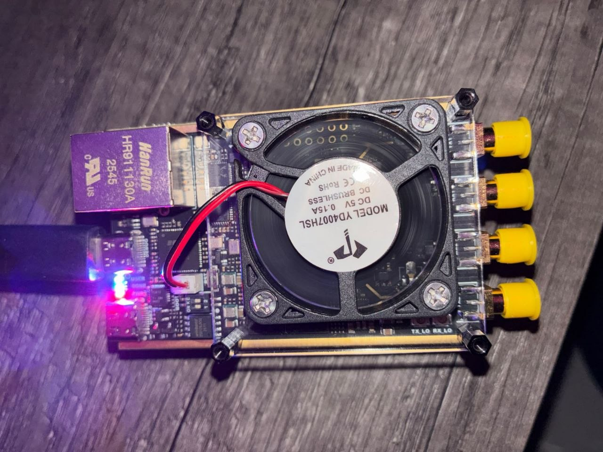
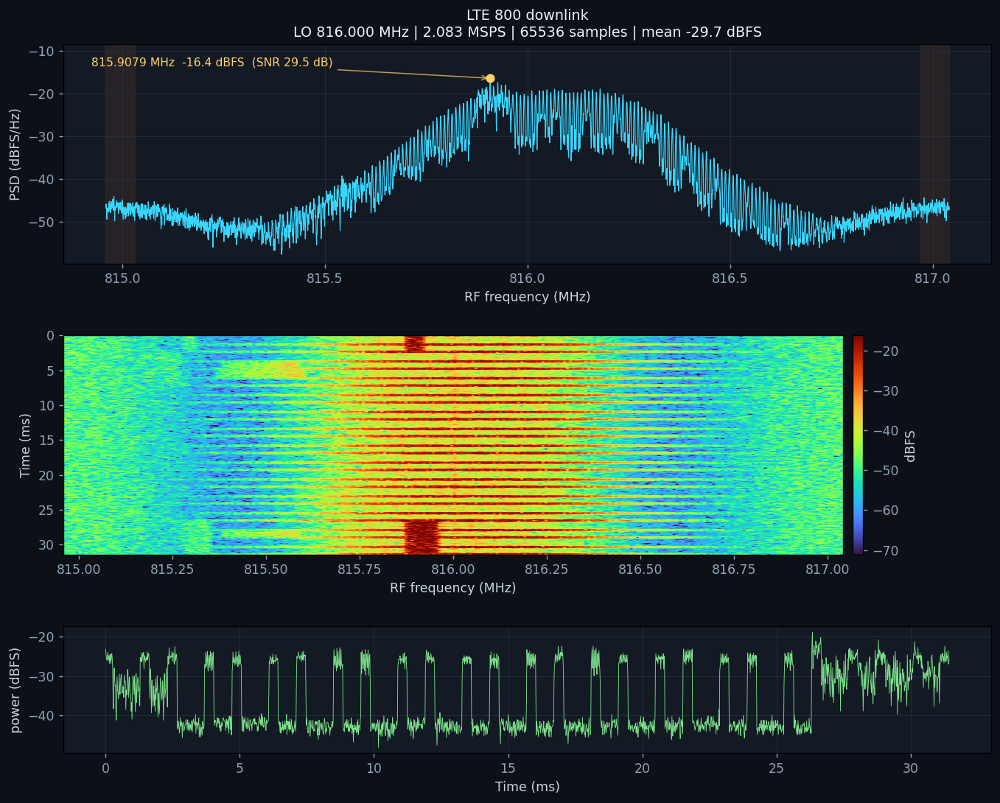
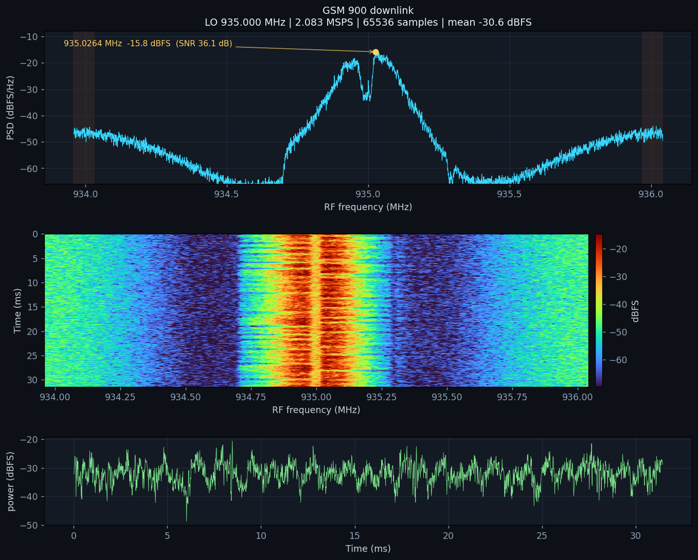
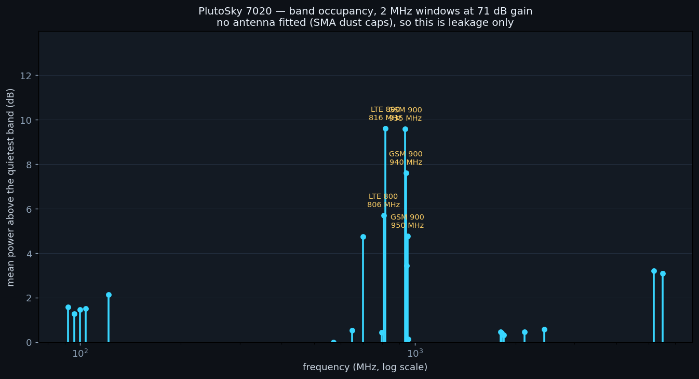

# sdr7020 — PlutoSky 7020 AD936X SDR

Working setup, capture and plotting tools for the **OpenSourceSDRLab PlutoSky 7020
AD936X** board (a PlutoSDR-compatible Zynq-7020 + AD9361 SDR).

Everything here was written against, and verified on, a real board:

| item | value |
|---|---|
| board | Analog Devices PlutoSDR Rev.C (Z7010/AD9363) — PlutoSky 7020 |
| firmware | PlutoSDR v0.38 port (`v0.38-1-g6f8e-dirty`) |
| transceiver | AD9361, 70 MHz – 6 GHz, 2×TX / 2×RX, up to 56 MHz bandwidth |
| USB ID | `0456:b673` (gadget) + `0403:6010` (FT2232H debug) |
| network | `192.168.2.1` over USB, also `192.168.2.1` over Ethernet |
| login | `root` / `analog` (ssh or serial) |
| serial console | `/dev/ttyUSB1` @ 115200 8N1 |
| measured | GSM-900 downlink captured at 935 MHz, 28 dB burst dynamics, see `captures/` |

---

## 1. Wire the board up



Ports, left to right along the edges:

* **RJ45** — Gigabit Ethernet (the board runs a DHCP client, `ssh root@<ip>`)
* **DEBUG** — micro-USB → on-board **FT2232H** (`0403:6010`), gives *serial
  console* (`/dev/ttyUSB1`, 115200) and JTAG (`/dev/ttyUSB0`). This port also
  powers the board on most revisions.
* **USB** — the *OTG data* port → this is the one that carries the PlutoSDR
  gadget (`0456:b673`), i.e. the sample stream. **If you only plug in DEBUG you
  get a console but no data link.**
* **SMA TX1 / RX1 / TX2 / RX2**, 50 Ω. Remove the yellow dust cap and screw an
  antenna onto **RX1** (the one nearest the fan) for receive.
* **DC jack** — 5 V / 2 A.

Minimum for receive: power + USB (OTG data port) + antenna on RX1.

## 2. Host setup (Ubuntu 24.04)

```bash
git clone https://github.com/yansyaf/sdr7020.git
cd sdr7020
sudo ./scripts/setup_host.sh          # libiio, iio tools, SoapySDR+PlutoSDR, gqrx, python deps
newgrp plugdev                        # or log out / log in once
```

`setup_host.sh` installs:

* `libiio` + `iio_info` / `iio_attr` / `iio_readdev` / `iiod`
* `libad9361`
* **SoapyPlutoSDR** (built from source — Ubuntu 24.04 has no package)
* `gqrx` and the gnuradio IIO bindings
* `python3-numpy scipy matplotlib pyserial`, optional `pyadi-iio`
* `/etc/udev/rules.d/99-plutosdr.rules` so the board works without root

## 3. Check that the host sees the board

```bash
lsusb | grep 0456                 # -> 0456:b673 Analog Devices, Inc. PlutoSDR
iio_info -s                       # -> context "usb:..." and "local:"/"ip:192.168.2.1"
ssh root@192.168.2.1              # password: analog
```

If `lsusb` shows only `0403:6010` (Digilent Adept), the cable is in the **DEBUG**
port. Move it to the **USB** port, or keep DEBUG for the console and add a
second cable to USB for data.

## 4. Capture a signal (the whole point)

```bash
scripts/capture.py --find                      # what contexts are there?
scripts/capture.py --freq 935e6 --samples 1e6 --out captures/gsm900
```

`capture.py` uses `pyadi-iio` when it is installed, otherwise the libiio CLI. It
writes:

* `captures/gsm900.npy` — complex64 samples (amplitude normalised to ±1)
* `captures/gsm900.json` — LO, sample rate, bandwidth, gain, backend, timestamp
* `captures/gsm900.png` — PSD + spectrogram + power envelope

Plot any capture again later:

```bash
scripts/plot_iq.py captures/gsm900.npy
scripts/plot_iq.py captures/gsm900.npy --out images/gsm900.png --title "GSM 900 downlink"
```

Useful options:

```bash
# frequency, sample rate, analog bandwidth, gain (max 71 dB), duration
scripts/capture.py --freq 100e6 --rate 5e6 --bw 4e6 --gain 60 --seconds 0.4

# 2.4 GHz Wi-Fi, two seconds of data
scripts/capture.py --freq 2.437e9 --rate 10e6 --seconds 2 --out captures/wifi
```

Keep `rate` ≤ `bw`, and remember the AD9361 minimum is 2.083 MSPS and the USB 2.0
link sustains roughly 8–10 MSPS of 16-bit I/Q before it starts dropping buffers.

## 5. Serial-only mode (no data USB port)

If only DEBUG is plugged in — or the USB gadget will not enumerate — the samples
can still be pulled through the serial console. It is slow (~4 kB/s) but it needs
nothing but the debug cable:

```bash
scripts/console.py "uname -a" "iio_info -s"      # poke the board
scripts/capture_serial.py --freq 935e6 --samples 65536 --out captures/serial_935M
scripts/plot_iq.py captures/serial_935M.npy
```

`capture_serial.py` logs in as `root`/`analog`, configures the AD9361 with the
board's own `iio_attr`, captures with `iio_readdev`, dumps the buffer as hex with
`od`, rebuilds it here and verifies the MD5 end-to-end.

## 6. Live spectrum in a GUI

```bash
gqrx
#  -> Device: "PlutoSDR [soapy]"   (SoapyPlutoSDR)
#  -> Input rate: 2083333 or 3072000, LNB LO 0, gain manual ~40-60 dB
```

Or with the SoapySDR CLI:

```bash
SoapySDRUtil --probe=driver=plutosdr
SoapySDRUtil --args="driver=plutosdr" --rate=2e6 --freq=935e6 --gain=50 --dump
```

## 7. Sweep the spectrum

```bash
scripts/band_survey.py                    # predefined VHF/UHF/cellular/Wi-Fi plan
scripts/band_survey.py --start 88 --stop 108 --step 2     # FM band in 2 MHz steps
scripts/band_survey.py --resume           # continue an interrupted sweep
```

Over the serial link the sweep uses `capture_serial.py` timings (~20 s per
frequency at 16 k samples). Over USB it is limited only by the settle time.

## 8. What was captured on this unit

No antenna was fitted during the first session (dust caps were still on the SMA
connectors), so everything below is leakage into an open RX port — a real
antenna improves it by tens of dB. Both records were pulled through the serial
console, i.e. with no USB data link at all.



**LTE 800 downlink, LO 816 MHz, 2.083 MSPS, 65 536 samples, 71 dB gain.**
A 1 MHz flat-top LTE carrier, OFDM sub-carriers visible as horizontal striations
in the spectrogram, 1 ms sub-frame periodicity in the envelope, peak 16 dBFS
(SNR 29.5 dB above the noise floor). Carrier frequency measured at 815.908 MHz.



**900 MHz cellular downlink, LO 935 MHz.** Two adjacent 200 kHz GSM carriers on
a continuous broadcast channel, peak 15.8 dBFS, SNR 36 dB. The notch in the
middle is the AD9361 DC-offset correction at the LO.



**Band occupancy, 23 windows of 2 MHz at maximum gain** (`captures/survey/`).
The 800 MHz LTE downlink and 930–950 MHz cellular downlink are ~10 dB above the
quietest windows; 3 GHz is flat and was used as the noise reference.

| LO | band | observation |
|---|---|---|
| 816 MHz | LTE 800 downlink | 1 MHz LTE carrier, SNR 29.5 dB, 1 ms sub-frames |
| 935 MHz | GSM 900 | two 200 kHz carriers, SNR 36 dB |
| 806 MHz | LTE 800 downlink | power 8 dB above noise floor |
| 947 MHz | GSM 900 | two carriers ~2 MHz apart |
| 3 GHz | (quiet reference) | flat, 6.8 dB envelope spread |

## 9. Troubleshooting

**`tuning failed` in the console log.** Some boards need the vendor's
`-no-tuning` firmware build (`PlutoSky-7020_*_no-tuning.zip` in the upstream
GitHub releases) — it differs only in the AD9361 init script.

**`lsusb` shows nothing.** Use a *data* cable (many micro-USB cables are
charge-only), plug into the **USB** port, and check `dmesg | tail` on the host.

**`iio_info` says "No IIO context found".** Install `libiio-utils`, then
`iio_info -s`. The board takes ~15 s to boot after power-on.

**Permission denied on `/dev/ttyUSB1`.** `sudo usermod -aG dialout $USER` and log
in again (the rules file already sets 0666, a replug may be needed).

**Overflows / dropped buffers.** Lower `--rate` or `--samples`; USB 2.0 tops out
around 8–10 MSPS. The board also exposes `oversampling_ratio` and
`rx_buffer_size` through `iio_attr`.

**Board is not reachable at 192.168.2.1.** The USB gadget takes ~10 s to come up;
`ip -br a` on the host should show an interface with 192.168.2.x. Over Ethernet
the board runs DHCP — check your router.

## 10. Firmware (optional)

The upstream repo ships SD-card and QSPI images:
<https://github.com/OpenSourceSDRLab/PlutoSky_7020_AD936X_SDR/releases>.
Booting from a FAT32 SD card is the safe way to try a different firmware: copy
`BOOT.BIN` and `image.ub` to the card root, keep the QSPI image intact, and remove
the card to boot the old firmware again.

## Repository layout

```
scripts/setup_host.sh      one-shot host installer
scripts/capture.py         capture (pyadi-iio, libiio CLI fallback)
scripts/capture_serial.py  capture through the FTDI serial console
scripts/plot_iq.py         PSD / spectrogram / envelope renderer
scripts/band_survey.py     frequency sweep with per-band power
scripts/console.py         run shell commands on the board over serial
scripts/watch_and_capture.py  auto-capture as soon as the board is plugged in
udev/99-plutosdr.rules     non-root access
captures/                  sample data (.npy/.raw/.json/.png)
images/                    figures used in this README
```

## Licence

MIT for the scripts. Firmware and hardware design are the vendor's (Apache-2.0 /
GPL components, see the upstream repository).
