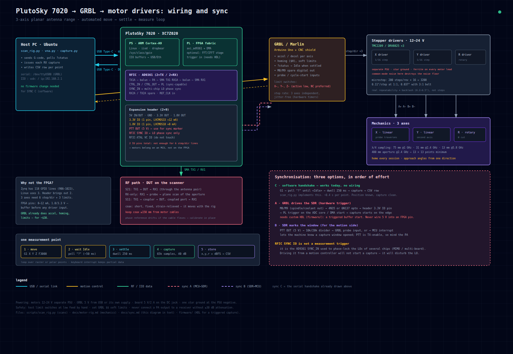

# sdr7020 — PlutoSky 7020 AD936X SDR

Setup, capture, transmit and custom-firmware tooling for the
**OpenSourceSDRLab PlutoSky 7020 AD936X** board (Zynq-7020 + AD9361, PlutoSDR
compatible).

Everything here was written against a real board, and is explicit about what has
been proven and what has not:

| item | value |
|---|---|
| board | Analog Devices PlutoSDR Rev.C (Z7010/AD9363) — PlutoSky 7020 |
| firmware | PlutoSDR v0.38 port (`v0.38-1-g6f8e-dirty`) |
| transceiver | AD9361, 70 MHz – 6 GHz, 2×TX / 2×RX, up to 56 MHz bandwidth |
| USB ID | `0456:b673` (data gadget) + `0403:6010` (FT2232H debug) |
| network | `192.168.2.1` over USB, DHCP over Ethernet |
| login | `root` / `analog` (ssh or serial) |
| serial console | `/dev/ttyUSB1` @ 115200 8N1 |
| **verified** | host stack, board control, RX and TX register paths, IQ capture and transfer, FFT shim simulation |
| **not yet** | no external signal received — the SMA ports are still capped, see §9 |

---

## 1. Wire the board up


* **RJ45** — Gigabit Ethernet, DHCP client (`ssh root@<ip>`).
* **DEBUG** — micro-USB to the on-board **FT2232H** (`0403:6010`): serial console
  on `/dev/ttyUSB1` (115200) and JTAG on `/dev/ttyUSB0`. This port also powers
  the board.
* **USB** — the **OTG data** port. This one carries `0456:b673` and therefore the
  sample stream. *Plugging only DEBUG gives you a console and no data link.*
* **SMA TX1 / RX1 / TX2 / RX2**, 50 Ω — remove the dust cap before use.
* **DC jack** — 5 V / 2 A.

Receive needs: power + a data cable in the USB port + an antenna on RX1.
Transmit needs: the same, plus a load on TX1 (see §5).

## 2. Host setup (Ubuntu 24.04)

```bash
git clone https://github.com/yansyaf/sdr7020.git
cd sdr7020
sudo ./scripts/setup_host.sh
newgrp plugdev     # or log out / in once
./scripts/check_setup.sh
```

Installs libiio + iio tools, libad9361, **SoapyPlutoSDR** (built from source —
Ubuntu 24.04 has no package), gqrx, the gnuradio IIO bindings, numpy/scipy/
matplotlib/pyserial, **pyadi-iio 0.0.14** (0.0.15+ requires libiio 1.x, noble
ships 0.25) and the udev rules.

## 3. Does the host see the board?

```bash
lsusb | grep 0456      # 0456:b673  -> the data port is connected
iio_info -s            # -> a "usb:" context
ssh root@192.168.2.1   # password: analog
./scripts/check_setup.sh --serial
```

Seeing only `0403:6010` means the cable is in DEBUG. That is still enough for
everything in §6, including a CW transmitter.

## 4. Receive

```bash
./scripts/capture.py --find
./scripts/capture.py --freq 935e6 --samples 1e6 --out captures/gsm900
./scripts/plot_iq.py captures/gsm900.npy        # PSD + spectrogram + envelope
```

`capture.py` prefers pyadi-iio and falls back to the libiio CLI. Output is
`<name>.npy` (complex64), `<name>.json` (LO / rate / gain / backend) and
`<name>.png`.

Useful knobs: keep `--rate` ≤ `--bw`; the AD9361 minimum is 2.083 MSPS; USB 2.0
sustains roughly 8–10 MSPS of 16-bit I/Q before it starts dropping buffers.

## 5. Transmit

```bash
./scripts/tx_example.py --mode cw    --freq 915e6 --tx-gain -40     # on-chip DDS
./scripts/tx_example.py --mode chirp --freq 915e6 --seconds 0.2     # DMA buffer
./scripts/tx_example.py --mode fm    --freq 100e6 --tx-gain -50
./scripts/tx_example.py --mode cw    --freq 915e6 --serial          # DDS over the console
```

| mode | how | notes |
|---|---|---|
| `cw` | AD9361 DDS | no samples streamed, so it also works with `--serial` (debug cable only) |
| `tone` / `chirp` / `fm` | TX DMA, cyclic buffer | needs the USB data port |
| `--loopback` | transmit, then capture on RX and measure the tone | proves the whole RF chain |

TX level: `tx_hardwaregain_chan0` runs from 0 dB (maximum) to −89.75 dB; the DDS
scale is 0..1 (0.1 is a sane start). Both TX outputs have a **PGA-102+ PA**, so
never point one at a receiver without attenuation.

**The loopback test settles the RX question** — TX1 → 30 dB attenuator → RX1:

```bash
./scripts/tx_example.py --mode chirp --loopback --freq 915e6
```

A tone tens of dB above the floor means LO, mixer, ADC, FPGA, DMA and IIO all
work, and any remaining silence on receive is purely the antenna.

`./scripts/ptt.py` keys the transmitter (`on`, `off`, `pulse --ms N`) through the
transceiver's TX enable, which is what drives the header's PTT OUT pin on stock
firmware; a GPIO in the custom bitstream is the alternative. See
[docs/sync.md](docs/sync.md) §6.

**RF safety and law.** A PA into an open or badly matched port can damage itself:
use a 50 Ω load or a properly attenuated cable. Transmitting into an antenna
needs the appropriate licence; bench work into a load does not.

## 6. Serial-only mode (no data USB port)

Samples can be pulled through the FTDI console: slow (~4 kB/s) but it needs
nothing but the debug cable.

```bash
./scripts/console.py "uname -a" "iio_info -s"
./scripts/capture_serial.py --freq 935e6 --samples 65536 --out captures/serial_935M
./scripts/plot_iq.py captures/serial_935M.npy
```

It logs in as `root`/`analog`, configures the AD9361 with the board's own
`iio_attr`, captures with `iio_readdev`, dumps the buffer as hex with `od`,
rebuilds it and verifies the MD5 end to end. It also fails loudly when the LO
does not read back what was asked (the vendor `-no-tuning` firmware issue).

## 7. Live spectrum

```bash
gqrx            # Device: "PlutoSDR [soapy]", rate 2083333 or 3072000, gain 40-60
SoapySDRUtil --probe=driver=plutosdr
```

## 8. Sweeps, and not fooling yourself

```bash
./scripts/band_survey.py --resume           # power per band, DC pedestal masked
./scripts/verify_signal.py --freq 935e6     # real signal or receiver artefact?
```

`verify_signal.py` is the important one. It captures twice with the LO shifted
and compares both spectra under two alignments:

* features at a fixed **absolute** frequency are radiated signals — they move
  through the window when the LO moves;
* features at a fixed **offset from the LO** are DC offset, 1/f noise, LO leakage
  or baseband spurs.

## 9. S11 / S21 measurements (VNA)

`scripts/vna.py` is a stepped-CW vector network analyser built on the board: CW
tone out of TX1, coherent complex detection on RX1, and real calibration.

```bash
# S21: gain/loss of a filter, cable, amplifier, or an antenna pair
./scripts/vna.py cal   --mode s21 --standard thru --start 400 --stop 500 --step 2
./scripts/vna.py sweep --mode s21 --start 400 --stop 500 --step 2 --out captures/filter

# S11: return loss / resonance -- needs a directional coupler or a bridge
./scripts/vna.py cal --mode s11 --standard open  --start 88 --stop 108 --step 0.5
./scripts/vna.py cal --mode s11 --standard short --start 88 --stop 108 --step 0.5
./scripts/vna.py cal --mode s11 --standard load  --start 88 --stop 108 --step 0.5
./scripts/vna.py cal --mode s11 --solve
./scripts/vna.py sweep --mode s11 --start 88 --stop 108 --step 0.5 --out captures/antenna
```

Wiring, the bridge schematic, why S11 is meaningless without a directional device,
`--ref-channel 1` (RX2 as incident monitor), Touchstone output and the accuracy
limits: [docs/vna.md](docs/vna.md). The calibration chain is verified — a
thru-calibrated repeat reads −0.19 dB / +0.42 dB.

## 10. 3-axis mechanics (planar antenna scans)

`scripts/scan_rig.py` drives three motors and captures a co-registered
measurement at every point — the mechanics half of an antenna range.

```bash
./scripts/scan_rig.py raster --mock --nx 9 --ny 9 --pitch 25 --out /tmp/scan_mock
./scripts/scan_rig.py raster --port /dev/ttyUSB0 --home --nx 9 --ny 9 --pitch 50 \
    --freq 2400e6 --dwell 0.3 --out captures/horn_2g4
./scripts/scan_rig.py polar --port /dev/ttyUSB0 --start -180 --stop 180 --step 2 \
    --freq 2400e6 --out captures/pattern_az
```

Motion goes through GRBL/Marlin over serial (Arduino + 3 stepper drivers), which
already handles acceleration, homing and limit switches. Output is a CSV with
`x_mm, y_mm, r_deg, mean_dbfs` plus a heatmap or polar plot.



Full wiring tables and the three sync modes (software handshake, GRBL hardware
trigger, SDR window marker) — plus what `RFIC SYNC IO` really is — are in
[docs/sync.md](docs/sync.md). `--sync idle` (default) polls GRBL's `?status`
until the machine reports `Idle`, so every row of the CSV carries a position the
controller actually reached, not one that was commanded.

**On the FPGA GPIO question:** the Zynq exposes 118 lines (`gpiochip0`, 906–1023)
and Linux is using three of them; the header itself carries **13 PL pins**
(4 × 3.3 V, 8 × 1.8 V, plus `PTT_IO`) — enough for 3 axes. What stock firmware
lacks is any way to reach them: no DT node, no GPIO driver binding. `EXPIO=1
./build.sh` adds an AXI GPIO over those pins (see firmware/README.md), after
which `devmem` drives them — plus a firmware-triggerable sync pulse out to the
motion controller and ILA cores on the GPIO word and the RF stream for
in-hardware checking. Levels differ per bank (1.8 V vs 3.3 V), which is the
practical constraint, not the pin count. So: use the header for a
trigger/sync line if you want hardware synchronisation, and let a $30 motion
controller own the motors. The reasoning, pin table, level limits, λ/4 sampling
rules, EMI rules and a pre-flight checklist are in
[docs/motor-rig.md](docs/motor-rig.md).

## 11. What this unit actually shows

**No external signal has been received yet.** The SMA connectors still carry
their dust caps, so RX1 is unterminated. In that state the AD9361 produces a
DC / 1-f pedestal roughly ±200–300 kHz wide that looks *very* convincing: with
the LO at 816 MHz it has a flat top that reads like an LTE carrier, and the
envelope shows periodic structure.

The retune test is what exposes it:

| LO | correlation at the same LO offset | at the same absolute frequency | verdict |
|---|---|---|---|
| 816 → 816.4 MHz | **+0.934** | −0.074 | artefact |
| 935 → 935.4 MHz | **+0.885** | +0.101 | artefact |
| 100 → 100.4 MHz | **+0.956** | −0.235 | artefact |

The pedestal follows the LO, so it belongs to the receiver, not to the air.

What *is* verified on this hardware:

* the board boots, the serial console works, `iio_info` lists the AD9361 and both
  DMA cores;
* RX gain −3…71 dB and LO tuning 70 MHz – 6 GHz both work and read back;
* 65 536-sample IQ records transfer intact (MD5-verified) over the console;
* the TX path configures correctly — TX LO 915 MHz readback, DDS channel
  enabled, attenuation applied (`tx_example.py --serial --mode cw` ran on the
  board).

To turn that into "a signal was captured", in this order:

1. screw an antenna onto **RX1** (a 20 cm wire in the centre pin is enough for FM
   and cellular), then
   `./scripts/verify_signal.py --freq 935e6` should report **REAL SIGNAL**;
2. or prove the chain electrically with a TX1→RX1 cable and
   `./scripts/tx_example.py --mode chirp --loopback`.

## 12. Custom FPGA firmware (FFT / IFFT)

`firmware/` builds a plutosdr-fw image with an FFT/IFFT stage in the receive
path, targeting **Vivado 2024.1 / 2024.2**.

```
firmware/
├── build.sh               clone + board patch + build  (--check, --topology)
├── hdl/system_bd_fft.tcl  block design: xfft + shim + AXI GPIO
└── hdl/ip/
    ├── axis_fft_shim.v       framing, FFT/IFFT select, bypass
    └── tb_axis_fft_shim.v    self-checking testbench (iverilog)
```

The shim and its testbench are verified here — `iverilog -g2012 -o /tmp/tb
tb_axis_fft_shim.v axis_fft_shim.v && vvp /tmp/tb` prints `PASS: all checks
passed`. The block-design TCL has **not** been run against a live hdl checkout
(there is no Vivado on this machine), which is why `build.sh --topology` exists:
it prints the real cell inventory before anything is inserted.

Size, integration, the pin/register map and safe flashing (SD card first, QSPI
only once it is proven): see [firmware/README.md](firmware/README.md).

## 13. Troubleshooting

**`tuning failed` in the log.** Some boards need the vendor's `-no-tuning`
firmware build; it differs only in the AD9361 init script.

**`lsusb` shows nothing.** Data cable, not a charge-only one, in the **USB**
port; check `dmesg | tail` on the host.

**`iio_info` finds no context.** `libiio-utils` installed? Has the board had ~15 s
to boot?

**Permission denied on `/dev/ttyUSB1`.** `sudo usermod -aG dialout $USER`, then
log in again (the shipped udev rule grants 0666).

**Overflows / dropped buffers.** Lower `--rate` or `--samples`; USB 2.0 tops out
near 8–10 MSPS.

**Board not at 192.168.2.1.** The gadget needs ~10 s; `ip -br a` should show a
192.168.2.x interface. Over Ethernet the board uses DHCP.

## Stock firmware

Vendor images:
<https://github.com/OpenSourceSDRLab/PlutoSky_7020_AD936X_SDR/releases>.
SD-card boot is the safe way to try firmware: keep QSPI intact, pull the card to
go back. Note the layout changed with plutosdr-fw 0.39 — v0.38 uses
`uImage` + `uramdisk.image.gz`, current builds use `BOOT.BIN` + `image.ub`.

## Repository layout

```
scripts/setup_host.sh        one-shot host installer
scripts/check_setup.sh       diagnose USB / IIO / serial / SoapySDR
scripts/capture.py           RX capture (pyadi-iio, libiio CLI fallback)
scripts/capture_serial.py    RX capture through the FTDI console
scripts/tx_example.py        TX: DDS CW, tone/chirp/FM buffers, loopback test
scripts/plot_iq.py           PSD / spectrogram / envelope
scripts/verify_signal.py     real signal vs receiver artefact
scripts/ptt.py               PTT / TX-enable: ensm, board GPIO, AXI GPIO
scripts/band_survey.py       frequency sweep
scripts/plot_survey.py       occupancy chart
scripts/console.py           run shell commands on the board over serial
scripts/watch_and_capture.py auto capture when the board appears
firmware/                    custom FPGA build (FFT/IFFT), Vivado 2024
udev/99-plutosdr.rules       non-root access
captures/                    raw IQ records (regression data, see §9)
```

`captures/raw_*.raw` are genuine recordings taken with the RX port unterminated —
useful as decoder regression data, not as examples of received signals.

## Licence

MIT for the scripts, TCL and Verilog here. Firmware and hardware design remain
the vendor's / ADI's (Apache-2.0, GPL-2.0 and LGPL-2.1 components).
