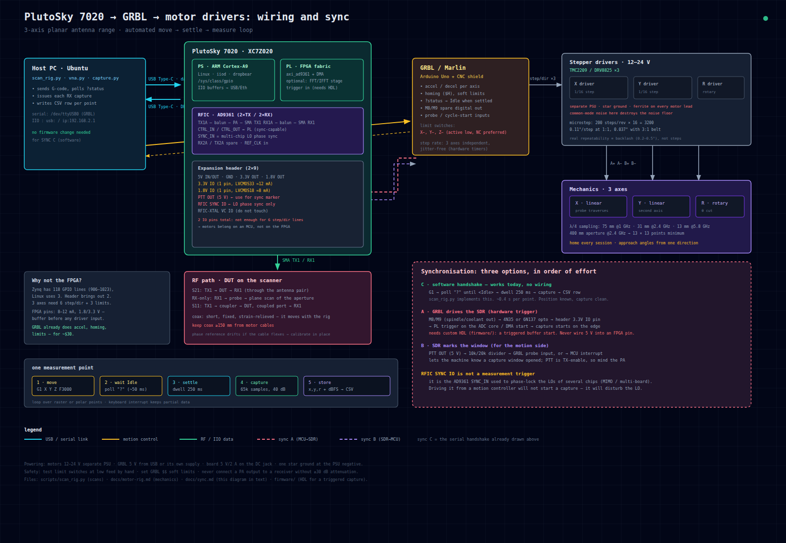

# Wiring PlutoSky 7020 → GRBL → motor drivers, and how to sync them



The diagram above is the whole system on one page. Source: `wiring-grbl.html`
(open it in a browser, or re-render with Chrome headless).

## 1. Connections

### PC side — two independent links

| link | cable | port | purpose |
|---|---|---|---|
| IIO data | USB Type-C (data) | `usb:` / `192.168.2.1` | samples, DDS, AD9361 attributes |
| console | USB Type-C (DEBUG) | `/dev/ttyUSB1` | root shell, recovery, `iio_attr` |
| motion | USB serial | `/dev/ttyUSB0` | GRBL: `G1`, `G4`, `?status` |

Use three separate USB ports if the hub allows it. A hub shared between the
stepper controller and the SDR is a noise injector.

### Board header → motion controller

The header carries **13 PL pins** (four 3.3 V, eight 1.8 V, plus `PTT_IO`) - see
`firmware/README.md` and `firmware/hdl/expio/`. On **stock firmware** none of them
is exposed to Linux, so out of the box the header is only usable as a sync node.
Once you build the bitstream with `EXPIO=1`, `scripts/ptt.py --backend devmem` can
drive `PTT_IO` (ball P14) as a real output.

| header pin | level | goes to | through |
|---|---|---|---|
| GND | 0 V | GRBL ground | direct, one wire |
| 3.3V IO | LVCMOS33 | GRBL input (probe / cycle-start) or MCU GPIO | **opto-isolator** (6N137 / 4N35) — never wire 5 V logic straight into it |
| PTT OUT | 5 V | GRBL input via 10k/20k divider, or MCU interrupt | divider → 3.3 V max |
| RFIC SYNC IO | 1.8–3.3 V | *nothing in this design* | see §4 |
| 5V IN/OUT | 5 V | GRBL 5 V rail (optional) | only if the Arduino is not USB-powered |
| 3.3V OUT / 1.8V OUT | rails | sensors only | never motor power |

### GRBL → drivers → motors

| GRBL pin | driver | note |
|---|---|---|
| D2, D3, D4 | step X, Y, Z | 3 axes: X, Y, and the rotary on Z |
| D5, D6, D7 | dir X, Y, Z | |
| D8 | enable (all) | active low on most shields |
| D9, D10, D12 | limit X/Y/Z | NC switches preferred, wired to GND |
| D11 / A3 / A5 | spindle PWM / cycle-start / probe | **the sync outputs** |

Motor power is **12–24 V, separate PSU**. Board power is 5 V / 2 A on its own DC
jack. One star point at the PSU negative; the motor current must not flow through
the coax shields.

## 2. The three ways to sync a move with a measurement

### C · software handshake — works today, no wiring

```
host: "G1 X40 Y0 F3000"  →  GRBL moves
host: "?"                →  "<Idle|MPos:40.000,0.000,0.000>"
host: sleep(dwell)       →  250 ms for mechanics + AD9361 DC/AGC loops
host: rx()               →  capture
host: write CSV row
```

`scripts/scan_rig.py --sync idle` does exactly this (default). ~0.4 s per point,
position read back from the controller rather than assumed. No firmware work, no
extra wires: this is what you should run first.

### A · GRBL drives the SDR — hardware trigger

```
GRBL D11/M8 ──[330R]── opto LED ──┐
                                  │  6N137 / 4N35
GRBL GND ────────────────────────┘
                    collector ── header 3.3V IO ── PL trigger
```

The motion controller asserts the line when the axis is in position; the FPGA
uses that edge to start the RX buffer. Jitter drops from milliseconds to a clock
cycle, and captures can happen while the axis is moving (useful for continuous
scans).

**The HDL for this now exists.** `firmware/hdl/expio/sync_pulse.v` generates the
pulse from either a software write or a hardware edge, drives it out on
`1V8_IO7_P` (L14), and takes the trigger back in on `1V8_IO7_N` (L15) — so the
same two pins give you SYNC A and SYNC B. Build with `EXPIO=1 ILA=1 ./build.sh`,
and monitor the handshake live with the ILA core while you bring it up.

Two caveats that decide whether you use it: both pins are on the 1.8 V bank
(outgoing needs a 74LVC1T45, incoming a divider), and driving the DMA *start*
from that edge — rather than just marking the window — still needs the buffer
trigger wired into the ADC core. The pulse itself is the easy half.

### B · SDR marks the window — for the motion side

PTT OUT (5 V) → divider → GRBL's probe input (or an MCU interrupt) tells the
machine that a capture window opened or closed. Useful when you want the
*mechanics* to wait for the radio rather than the other way round, e.g. to avoid
moving during a long coherent integration.

Caveat: PTT follows TX enable. With a PA on TX1, pulsing PTT keys the
transmitter — keep TX attenuation high and a load connected if you use this.

## 3. Timing budget per point

| step | typical | dominated by |
|---|---|---|
| move | 50–500 ms | distance / feed rate / acceleration |
| reach Idle | 10–50 ms | status poll interval (50 ms) |
| settle | 250 ms | frame vibration, AD9361 DC tracking |
| capture 65 k samples | 30 ms | 2.083 MSPS over USB 2.0 |
| store | <1 ms | CSV append |

So ~0.4 s per point: a 13 × 13 grid is about 70 seconds, a 31 × 31 grid about
7 minutes. The settle dwell is the knob — shorten it only after checking that
consecutive captures at the same point agree.

## 4. What "RFIC SYNC IO" actually is (and is not)

On the AD9361, `SYNC_IN` phase-locks the internal dividers of **several chips**
so their LOs and sampling clocks share a phase relationship — the MIMO /
multi-board case. On this board it is wired to that pin.

Consequences:

* driving it from a motion controller will **not** start a capture;
* pulsing it during a measurement can **pull the LO** and corrupt the data;
* if you ever add a second PlutoSky for a two-channel measurement, this is the
  pin that makes them coherent — that is its job.

The pins that can carry a general-purpose trigger on this board are **PTT OUT**
(5 V logic, easy to use) and the CTRL_IN/CTRL_OUT lines between the RFIC and the
PL (documented in the vendor block diagram, but not broken out on the header —
they need a firmware change and, realistically, your own carrier board).

## 5. First-run checklist

1. `M3`/`G1` moves each axis; `$H` homes; limit switches stop the machine at low
   feed, tested by hand.
2. `./scripts/scan_rig.py raster --mock` completes (no hardware).
3. `./scripts/scan_rig.py raster --port /dev/ttyUSB0 --nx 3 --ny 3 --pitch 50`
   on the real rig, watched closely, with one finger on the power switch.
4. Noise floor with motors energised vs disabled — should be identical. If not,
   fix grounding before measuring anything.
5. Then a coarse grid at λ/2 and look at the heatmap before refining.

## 6. PTT from Python

`scripts/ptt.py` asserts the board's PTT / TX-enable. Three backends, because
"PTT" is three different things here:

```bash
./scripts/ptt.py --diag                      # what does this board expose?
./scripts/ptt.py on                          # TX path on -> PTT asserted
./scripts/ptt.py off                         # alert: TX and RX down
./scripts/ptt.py pulse --ms 250              # marker, then back to the old state
./scripts/ptt.py on --keep                   # leave it keyed, exit

# custom device tree that frees a Zynq GPIO line (runs over the console)
./scripts/ptt.py on --backend gpio --gpio 1013

# custom bitstream with the FFT/AXI-GPIO block from firmware/
./scripts/ptt.py pulse --backend devmem --axi-base 0x41200000 --axi-bit 2
```

What works today, measured on this unit:

```
$ ./scripts/ptt.py --diag
  ensm_mode      : fdd     <- the PTT lever on stock firmware
  AD9361 GPOs    : none exported
  Zynq GPIO lines in use: 3   (led0, ulpi resetb, reset)
  devmem         : available

$ ./scripts/ptt.py pulse --ms 200
backend ensm, state before: fdd
asserted -> fdd for 200 ms
released -> alert
restored to fdd -> fdd
```

Notes that matter:

* **The header's PTT OUT is not a Linux GPIO** on stock firmware. It follows the
  transceiver's TX enable, which is why the `ensm` backend works and why you
  cannot toggle it independently without a firmware change.
* `alert` powers down **RX as well**. That is right for a half-duplex rig, but it
  will abort a capture in progress — which is exactly what you want if PTT is
  gating a measurement window.
* `pulse` restores the *previous* state, not "off". Starting from `fdd` leaves you
  in `fdd`, so a pulse does not silently kill your receiver.
* The board has no Python, so the `gpio` and `devmem` backends drive it with
  sysfs and busybox `devmem` **over the FTDI console**.
* The transmitter is attenuated to -30 dB before keying. With a PA and an open
  SMA that is not optional.
